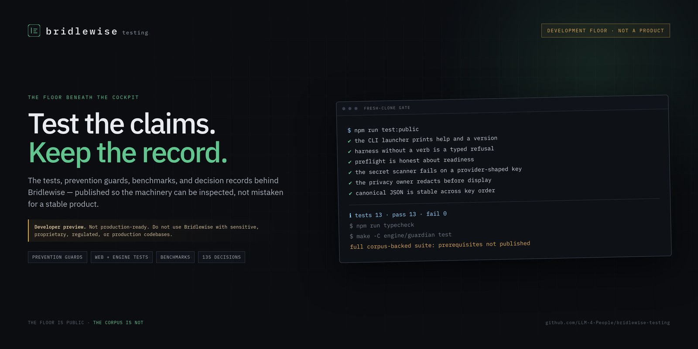

# bridlewise-testing

**The development floor for [Bridlewise](https://github.com/LLM-4-People/bridlewise): tests, prevention guards, benchmarks, design decisions, and verification machinery.**

<p align="center">
  
</p>

[](https://github.com/LLM-4-People/bridlewise-testing/actions/workflows/ci.yml)
[](https://llm-4-people.github.io/bridlewise-testing/floor/)
[](https://github.com/LLM-4-People/bridlewise-testing/actions/workflows/codeql.yml)
[](LICENSE)
[](#status)

## Start here

| I want to | Go to |
|---|---|
| Help test, review, or improve the floor | [How to help](https://llm-4-people.github.io/bridlewise-testing/floor/help/) · [CONTRIBUTING.md](CONTRIBUTING.md) |
| Build on the harness | [Building on the harness](docs/extending.md) · [Architecture](https://llm-4-people.github.io/bridlewise/architecture/) |
| See where the work is going | [Build roadmap](https://llm-4-people.github.io/bridlewise-testing/floor/roadmap/) |
| Verify a claim | [Floor evidence](https://llm-4-people.github.io/bridlewise-testing/floor/evidence/) · [Status](https://llm-4-people.github.io/bridlewise-testing/floor/status/) |
| Use the product | [Product repository](https://github.com/LLM-4-People/bridlewise) · [Product docs](https://llm-4-people.github.io/bridlewise/) |

## The site is a floor, not a product mirror

The testing site at <https://llm-4-people.github.io/bridlewise-testing/> starts with a **contributor hub**, not a copy of the product home. The complete product documentation is still mirrored on the site, with a [product documentation entry point](https://llm-4-people.github.io/bridlewise-testing/product/). The product home remains at <https://llm-4-people.github.io/bridlewise/>.

The development floor lives at <https://llm-4-people.github.io/bridlewise-testing/floor/>. It carries a generated test atlas, a public status snapshot, the promotion contract, the build roadmap, the contribution guide, and the evidence commands. The mirror is assembled from the public product docs at build time. It is not a second copy in Git.

The floor site is a record, not a hosted test service. It does not run suites, hold a token in your browser, or turn an unknown into a pass.

> [!WARNING]
> **This is not a product, and it is not production-ready.** Bridlewise is an experimental developer preview. Do not use it — or anything built from this repository — with sensitive, proprietary, regulated, or production codebases. Expect breaking changes, incomplete security guarantees, and data loss. Run it on disposable copies only.

## What this repository is

This is the **development floor** from which the Bridlewise product is projected. It carries the source tree plus the suites and records that are deliberately excluded from the product repository:

- unit, integration, prevention, cockpit, performance, and end-to-end tests;
- engine domain tests for the editor, intelligence, memory, privacy, safety, timeline, workflow, MCP, and quality packs;
- benchmarks for concurrency, storage, the ledger, payloads, redaction, and the write path;
- 134 decision records and a curated set of design and architecture essays;
- the test inventory, frozen records, verification tooling, and the guardian tests.

The product repository — cockpit, loopback server, engine, guardian, shared contracts, and public docs — is [`LLM-4-People/bridlewise`](https://github.com/LLM-4-People/bridlewise).

## Why two repositories

The product repository is a **curated projection**: it contains what a user needs to build and run the cockpit, without the private corpus, internal evidence, trackers, or the full test floor. This repository contains the machinery behind that projection. Keeping them separate means:

- the product clone stays small and buildable;
- the test and design record can be inspected without pretending it is a stable SDK;
- private fixtures and evidence are not published just to make a badge green.

The projection is described in `promotion/main-to-product.json`: the `product` branch of this repository is computed from `main` by it.

## Roadmap

The full [build roadmap](https://llm-4-people.github.io/bridlewise-testing/floor/roadmap/) is milestone based, with exit criteria and help lanes. The short version:

| Milestone | State | What must be true |
|---|---|---|
| M0 · Public floor online | Done | Both repositories, Pages, the public gate, failure reporting, promotion, and a prerelease are live. |
| M1 · Reproducible, sharded floor | Active | The full suite runs on shards, merges into one receipt, and every canonical test file runs once. |
| M2 · Admission evidence | Next | Readiness is reported per capability, with evidence and a remedy attached. |
| M3 · Product hardening | Next | Backup and restore are one verified flow; provider coverage, portability, scale, and accessibility still need tested failure paths. |
| M4 · Sustainable contribution | Active | A new contributor can go from clone to a merged test or docs change using only public instructions. |

No dates. A milestone closes when its exit criteria are reproducible, not when a badge changes.

## Quickstart

Requirements: Linux, Node `>=24.18.0 <25.0.0`, npm, Git, and a C compiler for the guardian.

```bash
git clone https://github.com/LLM-4-People/bridlewise-testing.git
cd bridlewise-testing
npm ci
npm --prefix engine ci
npm run bootstrap:hooks
chmod 600 engine/bridlewise.config.json
make -C engine/guardian all
npm --prefix engine run build:bundle
```

Run the public smoke suite — the part that works on a fresh clone without the private corpus:

```bash
npm run typecheck
npm --prefix engine run typecheck
npm run test:public
make -C engine/guardian all
make -C engine/guardian test
```

Start the app (same commands as the product repository):

```bash
node scripts/sd.mjs start
# http://127.0.0.1:5173/
node scripts/sd.mjs stop
```

The first account created owns the local harness. Add a provider in Settings before starting a chat run; there is no demo provider configured.

## The test floor

| Area | Path | Runner |
|---|---|---|
| Web unit and integration | `tests/unit/` | Vitest |
| Prevention guards | `tests/prevention/` | Vitest |
| Cockpit surfaces | `tests/cockpit/` | Vitest + browser setup |
| Performance regressions | `tests/performance/` | Vitest |
| End-to-end | `tests/` | Playwright |
| Engine domains | `engine/test/` | `node:test` |
| Live provider/MCP | `engine/live/` | `node:test`, opt-in |
| Benchmarks | `bench/` | Node harness |
| Guardian | `engine/guardian/tests/` | C + shell |

The floor site's published links are guarded by `scripts/floor/site-links.mjs`
(the built `_site` crawl before deploy) and unit-tested by
`tests/unit/floor-site-links.test.ts`; `npm run docs:links` also refuses a
floor page linking a docs path the assembler does not publish.

```bash
npm test                    # root web suite (watchdog)
npm run test:raw            # vitest under the harness slot
npm run test:e2e            # Playwright
npm --prefix engine test    # full engine suite
npm --prefix engine run test:guards
npm --prefix engine run test:editor
node --experimental-strip-types bench/run.ts
```

### Full-suite prerequisites

A fresh clone cannot run the full suites. The runners refuse with a named prerequisite instead of silently skipping:

- The external 4.1 GB corpus used by the engine suite. It is not published.
- The generated performance report under `tests/performance`, produced by `npm run perf:profile`; the performance regression test requires it.
- **Playwright Chromium** — `npx playwright install --with-deps chromium`.
- **User systemd** — used by the long-task-runner test.
- **`openssl`** — used by the outbound-HTTP test.
- **Landlock** — the guardian tests skip the kernel path with exit 3 when the host does not expose it. A skip is not a pass.

CI is generated. One gate catalogue (`engine/src/workflow/gates/`) declares every gate; `harness sync` writes every file under `.github/workflows/` from it, and `harness check` refuses a hand edit. The same verbs run locally:

```bash
cd engine
node src/cli.ts harness gates list                                   # the catalogue
node src/cli.ts harness gates plan --out ../.bridlewise/gates        # this tree's populations and shard cells
node src/cli.ts harness gates run docs-links --plan ../.bridlewise/gates/plan.json --out ../.bridlewise/gates/results
node src/cli.ts harness gates shard web-suite-1 --plan ../.bridlewise/gates/plan.json --out ../.bridlewise/gates/results
```

The web population is every file the runner's own globs select less the catalogue's named exclusions; the engine population is its test inventory. The seal merges every cell's result into one receipt and refuses a missing, duplicate, unexpected, failed or wrong-commit cell. See [docs/testing.md](docs/testing.md) for the gates, the exclusions and the receipt contract.

## CLI tools

The engine CLI ships in both repositories. It exposes `preflight`, `quality`, and the `harness` workflow verbs:

```bash
./bin/bridlewise.mjs --help
./bin/bridlewise.mjs preflight
./bin/bridlewise.mjs harness
./bin/bridlewise.mjs harness check --skip-typecheck
./bin/bridlewise.mjs harness format --check
./bin/bridlewise.mjs harness timeline --text
./bin/bridlewise.mjs harness metrics --text
```

The preflight receipt is deliberately honest:

```json
{ "harnessReady": false, "stage": "s1-preflight-only" }
```

Model invocation, repository mutation, process execution, and network egress are denied by the root policy until their admission gates close. See [docs/cli.md](docs/cli.md) for every verb, the development scripts, `trace.ts`, `db-key`, and the guardian commands.

## Building on the harness

[docs/extending.md](docs/extending.md) covers the extension points:

- add a **block** — one declaration emits the route, validation, client binding, schema entry, and UI contract;
- add a **tool** — one governed manifest and one executor, with typed refusals;
- add a **provider** — the Responses adapter and the encrypted provider store;
- add an **MCP server** — stdio, Streamable HTTP, or WebSocket, with Landlock confinement for stdio;
- **embed the engine** — the public barrel in `engine/src/index.ts`;
- add a **quality check** or language pack;
- add a **test** at the right layer.

## Documentation

| Document | What it covers |
|---|---|
| [Contributor hub](https://llm-4-people.github.io/bridlewise-testing/) | How to help, how to build on the harness, and the roadmap |
| [How to help](https://llm-4-people.github.io/bridlewise-testing/floor/help/) | Contribution lanes, a first-hour path, and the review checklist |
| [Build roadmap](https://llm-4-people.github.io/bridlewise-testing/floor/roadmap/) | Milestones, workstreams, exit criteria, and help wanted |
| [docs/testing.md](docs/testing.md) | The test map, prerequisites, commands, and how to add a test |
| [docs/cli.md](docs/cli.md) | CLI, dev lifecycle, ledger inspection, database keys, guardian |
| [docs/extending.md](docs/extending.md) | Blocks, tools, providers, MCP, embedding, quality packs |
| [docs/shipping.md](docs/shipping.md) | Build outputs, verification, release assets, rollback |
| [docs/decisions/](docs/decisions/) | 134 decision records |
| [docs/floor/](docs/floor/) | Source pages for the generated development-floor site |
| [docs/design/](docs/design/) | Selected cockpit, performance, and structure essays |
| [https://llm-4-people.github.io/bridlewise/architecture/](https://llm-4-people.github.io/bridlewise/architecture/) | Architecture and migration design records |

The public product docs live at <https://llm-4-people.github.io/bridlewise/> once the site is published.

## Status

- **Readiness:** pre-admission. `preflight` reports `harnessReady: false`; the admission gates are open.
- **Platform:** Linux-first. Landlock is Linux-only; WSL has documented caveats.
- **Tests:** typecheck and the public smoke suite are green on a fresh clone. The full corpus-backed suite is not reproducible from the public snapshot.
- **Security:** not audited. Do not use with sensitive code.
- **Support:** none. This is a volunteer preview.

## Contributing

Read [CONTRIBUTING.md](CONTRIBUTING.md) and [SECURITY.md](SECURITY.md). A contribution needs evidence, a focused scope, and no secrets or private data. AI-assisted work is welcome when disclosed and verified.

## License

AGPL-3.0-only. See [LICENSE](LICENSE) and [THIRD_PARTY_NOTICES.md](THIRD_PARTY_NOTICES.md).

---

**Every run, recorded. Every tool, governed.** But not yet ready for your production code.
